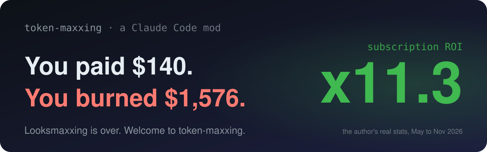

<p align="center">
  
</p>

<h1 align="center">token-maxxing</h1>

<p align="center">
  <b>Looksmaxxing is over. Welcome to token-maxxing.</b><br>
  A Claude Code mod that shows how much your flat-rate plan is quietly costing Anthropic:<br>
  tokens per model, the API bill you dodged, and your subscription ROI. In one pane.
</p>

<p align="center">
  
  
  
  
</p>

---

## Why

You pay $20 a month. You use Claude Code like it owes you money.
At some point you have to ask the question of our generation:

> *"How much would I have paid if I was on the API, like a responsible adult?"*

token-maxxing answers it. To the cent. Cache included. No cap.

## The author's receipts

Real numbers, May to November 2026:

| | |
| --- | ---: |
| Tokens burned | **2.77 billion** |
| What it would have cost on the API | **$1,576** |
| What I actually paid | **$140** |
| Subscription ROI | **x11.3** 🟢 |

Somewhere in San Francisco, a CFO just whispered my name with hatred. 😭

## What you get

- 📊 **Tokens per model**, this month and all time
- 💸 **The API bill you dodged**, at public API prices, cache writes and reads included
- 🟢 **Your ROI**: green when you're farming, red when you're getting played
- 📈 **A monthly chart**, because number go up is the only cardio we do
- 🖼️ **A profile picture frame** with your ROI on it, #OpenToWork style, but for people who actually work
- ⚡ **Fast**: only new lines are read, after each Claude reply
- 🔒 **100% local**: reads files already on your disk and sends nothing anywhere (unlike your dignity)

Works in the Claude Code CLI, the desktop app and VS Code.

## Install (10 seconds)

In Claude Code, in a terminal:

```
/plugin install token-maxxing --marketplace JCK-Sabords/token-maxxing
```

From your shell:

```
claude plugin install token-maxxing --marketplace JCK-Sabords/token-maxxing
```

In the desktop app: click **+** next to the prompt, then **Plugins**, **Add marketplace** with `JCK-Sabords/token-maxxing`, then **Add plugin**.

Requires Claude Code v2.1.287 or later (v2.1.286 or later in the desktop app).

## Flex responsibly

Tell it what you pay, so it can tell you how hard you're winning:

```
/plugin configure token-maxxing@token-maxxing
```

| Option | Default | What it does |
| --- | --- | --- |
| `planPriceUsd` | `0` | Your plan price per month (20, 100, 200...). Shows your ROI this month and all time. `0` hides it. |
| `openOnNewSession` | `true` | Opens the pane when a new session starts. |
| `language` | `en` | `en` or `fr`. Oui, on parle français. |

## Usage

- The pane opens by itself when you start a new session.
- Type `/tokens` to open it anytime.
- No UI? `claude -p "/tokens"` prints the receipts right in your terminal:

```
token-maxxing · API-equivalent cost · all time
$1,576  ·  2.77B tokens  ·  11,641 replies
Subscription $140 over 7 months · ROI x11.3

opus-5      ███████░░░░░       $884     1.00B
opus-5-5    ███░░░░░░░░░       $332    793.7M
sonnet-5    ██░░░░░░░░░░       $259    734.0M
sonnet-5-5  ░░░░░░░░░░░░     $49.05    179.4M
opus-4-8    ░░░░░░░░░░░░     $32.64     28.8M
```

## Flex it 🗿

Numbers in a terminal are cute. Numbers on your LinkedIn profile picture are a lifestyle.

1. Press **Flex it on your profile pic** in the pane. It opens [the flex page](https://jck-sabords.github.io/token-maxxing/flex/) with your score already loaded.
2. Add a photo, or just type your GitHub username.
3. Pick a style (Open to ROI, Gold flex, Terminal), download, upload it everywhere, watch recruiters get confused.

Your photo never leaves your browser: the frame is drawn on your machine. The free version carries a tiny "made with token-maxxing" mark. In marketing, we call that a feature.

## How the math works (for the nerds)

- **Source**: Claude Code's local transcripts (`~/.claude/projects/**/*.jsonl`). Cloud sessions and claude.ai chats leave nothing on your disk, so they don't count. Sorry, your best work happened off the books.
- **One reply, counted once**: transcripts write several lines per reply, a partial output count first and the final one last. The mod keeps the final one.
- **Prices**: Anthropic's public API rates (November 2026). Cache writes at 1.25x input (5 min) or 2x (1 h), cache reads at each model's own rate, fast mode at 2x. It's all in `PRICES` in `hooks/register.tsx`.
- **Incremental**: a cache in `~/.claude/token-maxxing/cache.json` remembers what was already read, and keeps your all-time total even after Claude Code deletes old transcripts. Your sins are remembered.

## FAQ

**Will this get me banned?**
No. It reads files that are already on your disk and does arithmetic. It never touches your account or the network.

**My numbers look low.**
Only local sessions count (see above). Or you're just not maxxing hard enough. Skill issue.

**My ROI is x1. Is that bad?**
You're paying for a gym membership you never go to. Respectfully: cooked.

**Anthropic changed its prices.**
Update `PRICES` in `hooks/register.tsx` and open a PR. You'll be a hero.

**It doesn't know a model that came out last week.**
Its tokens still show up, at $0 until it has a price. PRs welcome.

## Contributing

PRs welcome, especially if you're funnier than me (low bar).
Run the tests with `claude plugin test .`

If this made you feel something (shame, mostly), drop a ⭐ and post your ratio.

## License

MIT. Do whatever you want. Just post your ratio.

token-maxxing is a fan project. Not affiliated with Anthropic, who would probably prefer you didn't know these numbers.
